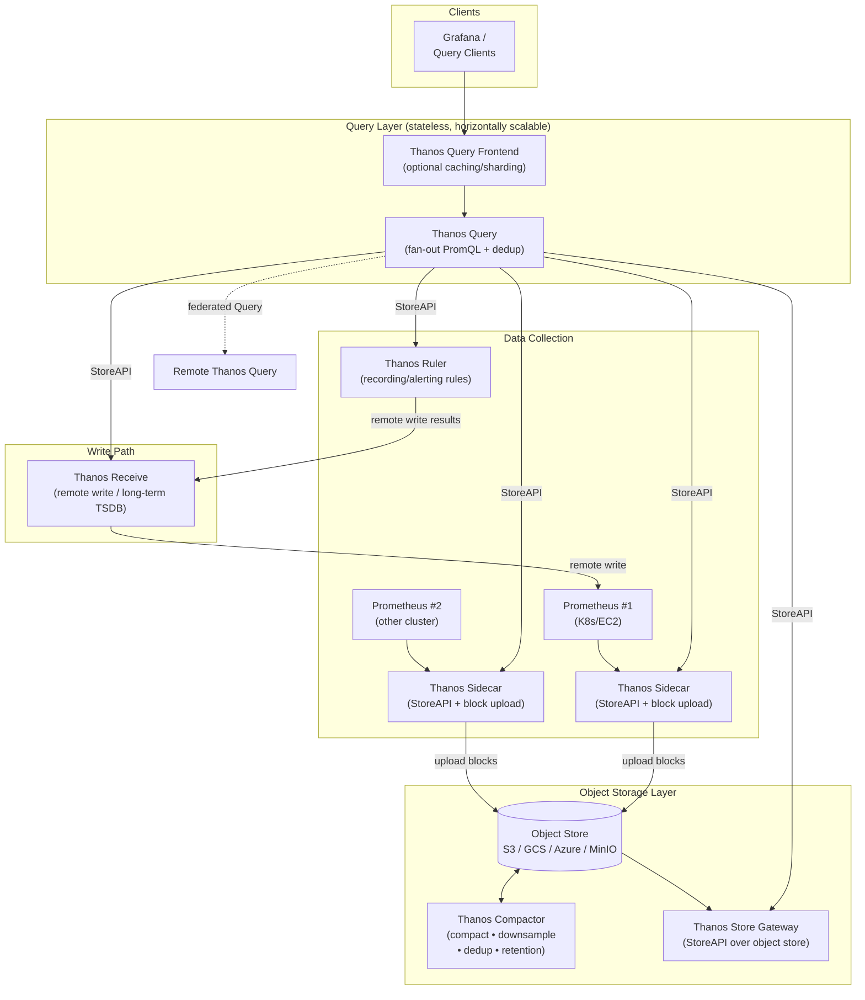

# Thanos Hands-On

A hands-on learning repo for [Thanos](https://thanos.io) — highly available Prometheus setup with long-term storage.

## Thanos Architecture



### Component Overview

| Component | Role |
|---|---|
| **Sidecar** | Runs beside Prometheus, exposes local TSDB via StoreAPI and uploads blocks to object storage. |
| **Store Gateway** | Serves historical blocks from object storage via StoreAPI (scalable read path). |
| **Query** | Stateless query engine that fans out PromQL to all StoreAPI sources and deduplicates series. |
| **Query Frontend** | Optional caching and sharding layer in front of Query. |
| **Receive** | Accepts Prometheus `remote_write`, stores it in a long-term TSDB, serves StoreAPI (multi-tenant write path). |
| **Compactor** | Global singleton: compacts, downsamples (5m → 1h), applies retention, deduplicates HA pairs. |
| **Ruler** | Evaluates recording/alerting rules against stored data and pushes results via `remote_write`. |

### Data Flow (short)

1. Prometheus scrapes metrics and writes to its local TSDB.
2. **Sidecar** uploads TSDB blocks to object storage and exposes StoreAPI.
3. **Receive** optionally accepts `remote_write` for a centralized write path.
4. **Compactor** compacts/downsamples blocks in object storage.
5. **Query** fans out PromQL across Sidecars, Store Gateway, Receive, and Ruler — deduplicating along the way.
6. **Grafana** queries the single Query endpoint like a normal Prometheus.

## Getting Started

```bash
# Clone the repo
git clone <repo-url>
cd thanos-hands-on
```

_Coming soon: docker-compose setup with Prometheus, Thanos Sidecar, Store Gateway, Query, and MinIO._
