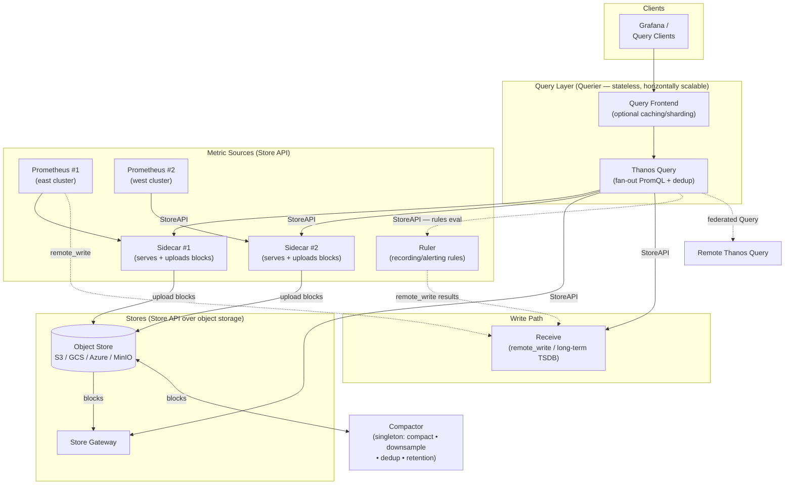

# Thanos Architecture

Reference: [Official Thanos Design doc](https://thanos.io/tip/thanos/design.md/), [Quick Tutorial](https://thanos.io/tip/thanos/quick-tutorial.md/) and [Components](https://thanos.io/tip/thanos/getting-started.md/).

## Official architecture diagrams

Straight from the [official Thanos README](https://github.com/thanos-io/thanos#architecture-overview) and [Quick Tutorial](https://thanos.io/tip/thanos/quick-tutorial.md/):

### Deployment with Sidecar (for Kubernetes)

*Source: [thanos-io/thanos README](https://github.com/thanos-io/thanos/blob/main/README.md) — original drawing [here](https://docs.google.com/drawings/d/1AiMc1qAjASMbtqL6PNs0r9-ynGoZ9LIAtf0b9PjILxw/edit?usp=sharing).*

### Deployment with Receive (scale-out / remote-write sources)

*Source: [thanos-io/thanos README](https://github.com/thanos-io/thanos/blob/main/README.md) — original drawing [here](https://docs.google.com/drawings/d/1iimTbcicKXqz0FYtSfz04JmmVFLVO9BjAjEzBm5538w/edit?usp=sharing).*

> **Note:** This lab follows the **Sidecar** deployment pattern (Prometheus + Sidecar → Thanos Query), but without object storage — see the "Production considerations" section of the [README](../README.md).

The official docs group Thanos components into three categories — **metric sources**, **stores**, and **queriers** — plus the write path (**Receive**) and the **Compactor** (a singleton that works directly on object storage and does not join the Thanos cluster).

### Component roles

| Component | Official category | Role |
|---|---|---|
| **Sidecar** | Metric source | Runs beside Prometheus, exposes the local TSDB via StoreAPI and uploads blocks to object storage. |
| **Store Gateway** | Store | Gateway to historical blocks in object storage; implements the same StoreAPI as sources. |
| **Query (Querier)** | Query layer | Stateless, horizontally scalable PromQL engine; fans out to all StoreAPI nodes and deduplicates. |
| **Query Frontend** | Query layer | Optional caching and query-sharding layer in front of Query. |
| **Receive** | Write path | Accepts Prometheus `remote_write`, stores it in a long-term TSDB, exposes StoreAPI. |
| **Ruler** | Metric source | Evaluates recording/alerting rules (discovering Query nodes), pushes results via `remote_write`. |
| **Compactor** | (standalone) | Singleton pointed at the bucket; compacts, downsamples, deduplicates, applies retention. Not part of the cluster. |

### Data flow (short)

1. Prometheus scrapes metrics into its local TSDB.
2. The **Sidecar** uploads TSDB blocks to object storage and serves StoreAPI for recent data.
3. The **Store Gateway** serves historical blocks from object storage via StoreAPI.
4. **Receive** optionally accepts `remote_write` for a centralized, push-based write path.
5. The **Compactor** compacts/downsamples blocks in object storage (single instance per bucket).
6. **Query** fans out PromQL across Sidecars, Store Gateway, Receive, and Ruler — deduplicating HA pairs along the way.
7. **Grafana** (or any PromQL client) queries the single Query endpoint like a normal Prometheus.
